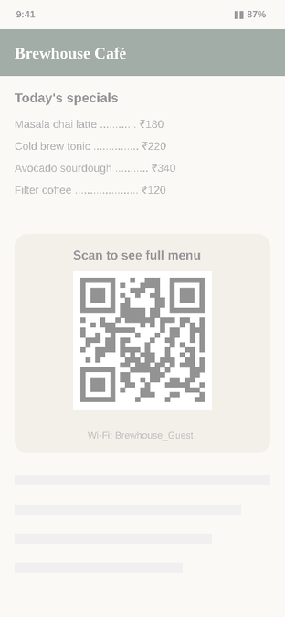

<div align="center">

# QR Lens

**Scan any QR code that's already on your screen. No camera, no screenshots, no copy-paste.**

Press a volume-key shortcut anywhere: the screen freezes, a scan sweeps across it, and QR Lens zooms straight into the code and shows you what's inside.



[**⬇ Download the latest APK**](https://github.com/CoolNinja2009/QRLens/releases/latest/download/QR-Lens.apk) · [All releases](https://github.com/CoolNinja2009/QRLens/releases)

Android 11+ · works offline · no internet permission · free and open source

</div>

---

## Why

Someone sends you a QR code on WhatsApp. A payment QR is on a website. A Wi‑Fi code sits in a PDF. Normally you'd need a second phone, or take a screenshot, open a scanner app, pick the image… QR Lens does it in one gesture, right where you are.

## Features

- **One shortcut, any app.** Pick the one you like:
  3× Volume Up · 2× Volume Up · 3× Volume Down · 2× Volume Down · both volume keys together · Volume Up then Down · long-press Volume Up.
  Presses that aren't part of your shortcut still change the volume normally.
- **Smooth, focused animation.** The screen shrinks into a card, a scan line sweeps over it, brackets lock onto the code and the view zooms in while everything else blurs away.
- **Several codes at once.** When there's more than one QR code on screen, all of them are outlined and labelled (Link, UPI, Wi‑Fi…). Tap the one you want; tap outside or press Back to pick another.
- **Knows what it's looking at.**

  | QR code contains | QR Lens shows |
  |---|---|
  | Website link | The site name, full URL and an **Open** button |
  | UPI payment | Payee and amount; **Open** hands it to your UPI app |
  | Wi‑Fi | Network name and password; **Connect** saves it and joins if it's in range |
  | Contact (vCard / MeCard) | **Open** adds it via your Contacts app |
  | Calendar event | **Open** adds it via your Calendar app |
  | Email, phone, SMS, map location | Opens the matching app |
  | Plain text | **Open** shows it in your phone's text viewer |

- **Copy and Share** buttons for anything it finds.
- **Finds tricky codes too:** dark-mode (inverted), rotated, tiny or huge codes.
- **Private by design.** Everything happens on your phone. QR Lens has no internet permission, so nothing it sees can leave your device.

## Install

1. Download [`QR-Lens.apk`](https://github.com/CoolNinja2009/QRLens/releases/latest/download/QR-Lens.apk) on your phone and open it.
2. If Android asks, allow your browser or file manager to **install unknown apps**.
3. **If Google Play Protect blocks the install:** in some regions (e.g. India), Play Protect automatically blocks sideloaded apps that use Accessibility. Open the **Play Store** → your profile picture → **Play Protect** → ⚙️ → turn off **Scan apps with Play Protect**, install QR Lens, then turn scanning back on. QR Lens keeps working with Play Protect on.

## Set up (one time)

1. Open QR Lens and tap **Turn on**, then switch **QR Lens** on in Accessibility settings.
2. **Android 13+ says "Restricted setting"?** That's normal for apps installed outside the Play Store. Tap the greyed-out QR Lens entry once, then go to **App info** → **⋮** (top right) → **Allow restricted settings**, and switch it on again.
3. Choose your shortcut in the app, and you're done.

## Why does it need Accessibility?

It's the only way Android lets an app:

- **listen to the volume keys** while you're in other apps, and
- **capture the screen** without a "Start recording?" prompt every time.

QR Lens uses it for exactly those two things. It does not read the content of other apps' windows (`canRetrieveWindowContent` is off), and since it has no internet permission, nothing is ever sent anywhere. The full source is in this repo if you want to check.

## FAQ

**My banking / UPI app (e.g. BHIM) refuses to open.**
Some banking apps block themselves while any accessibility app from outside the Play Store is switched on. QR Lens switches itself off automatically when these apps open. To turn it back on, use Android's accessibility shortcut (hold **both volume keys for 3 seconds**; set it up from the QR Lens app) or the **QR Lens** tile in Quick Settings. You can turn auto-pause off in the app.

**It says "No QR code on screen" but I can see one.**
Some apps block screenshots (banking apps, DRM video, incognito tabs). Every screenshot tool sees a black screen there, including QR Lens.

**Can I use the Power button as a shortcut?**
No. Android never passes the Power button to apps.

**Wi‑Fi: why do I still have to tap "Save"?**
Since Android 10, no app can join a Wi‑Fi network silently. QR Lens opens Android's own "Save network?" sheet with everything filled in; one tap saves it and connects if the network is nearby. If it isn't, your phone joins automatically later.

**How do I update?**
Download the new APK from [Releases](https://github.com/CoolNinja2009/QRLens/releases) and install it over the old one. Your settings are kept.

## Build from source

Requirements: JDK 17 and the Android SDK (or just Android Studio).

```bash
git clone https://github.com/CoolNinja2009/QRLens.git
cd QRLens
./gradlew assembleRelease        # gradlew.bat on Windows
# → app/build/outputs/apk/release/app-release.apk
```

Without the release keystore, builds are signed with your local debug key, so they won't install over the official APK: uninstall it first. Every push also builds an APK with GitHub Actions (`.github/workflows/build.yml`).

<details>
<summary>Project layout</summary>

`app/src/main/java/com/qrlens/app/`

| File | What it does |
|---|---|
| `QrLensService.kt` | Accessibility service: key events, screenshot, auto-pause for banking apps, settings |
| `TriggerEngine.kt` | Turns volume-key presses into the chosen shortcut; replays stray presses as normal volume changes |
| `QrDetector.kt` | Finds every QR code in the screenshot (ZXing; normal + inverted, full + half resolution) |
| `ScanView.kt` | All animation: shrink, scan sweep, lock-on brackets, zoom camera, overview, blur |
| `OverlayController.kt` | Overlay window, result card, action bar, multi-code flow, Wi‑Fi countdown |
| `QrContent.kt` | Parses QR text into links, UPI, Wi‑Fi, contacts, events, SMS, email, plain text |
| `QrActions.kt` | Opens / copies / shares results, Wi‑Fi connect, files for native viewers |
| `ShareProvider.kt` | Small read-only provider so viewer apps can open those files |
| `QrLensTile.kt` | Quick Settings tile to pause / resume |
| `MainActivity.kt` | Setup screen, shortcut picker, options |
| `Blur.kt` | Fast background blur |

</details>

<details>
<summary>Maintainer notes: release signing</summary>

The release keystore is not in the repo (`.gitignore` blocks it). GitHub Actions recreates it from the `KEYSTORE_BASE64` repository secret (optional `KEYSTORE_PASSWORD`). Never commit the keystore or post its base64 text: anyone with it can sign apps that install as updates to QR Lens.

**Releasing:** change `appVersion` at the top of `app/build.gradle.kts` (bugfix `1.3.0 → 1.3.1`, feature `→ 1.4.0`, big change `→ 2.0.0`) and push. Actions builds it and publishes release `v1.3.1` with the APK and auto-generated notes. Pushing code without bumping the version builds a test APK (under the run's Artifacts) but doesn't publish a release.

</details>

## Credits

QR detection by [ZXing](https://github.com/zxing/zxing) (Apache 2.0).
